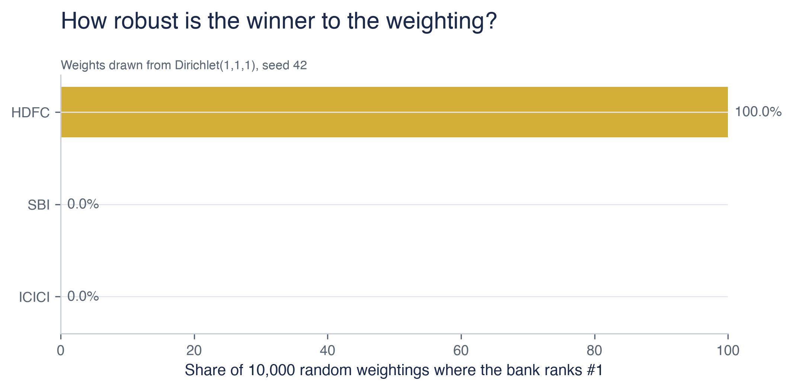
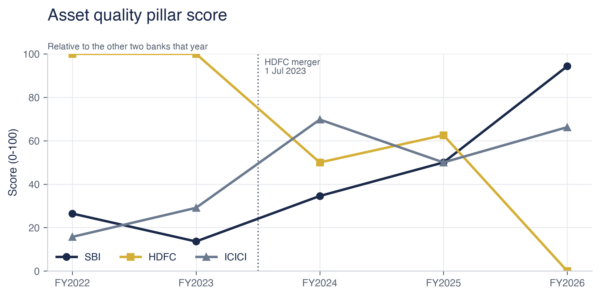
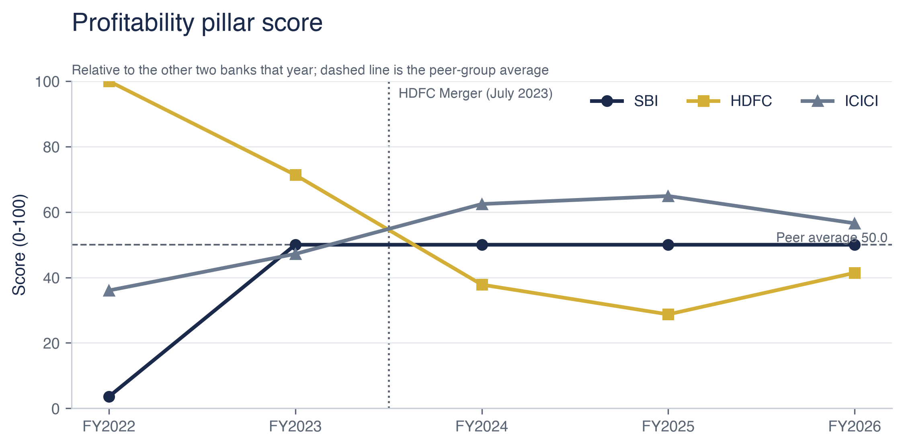
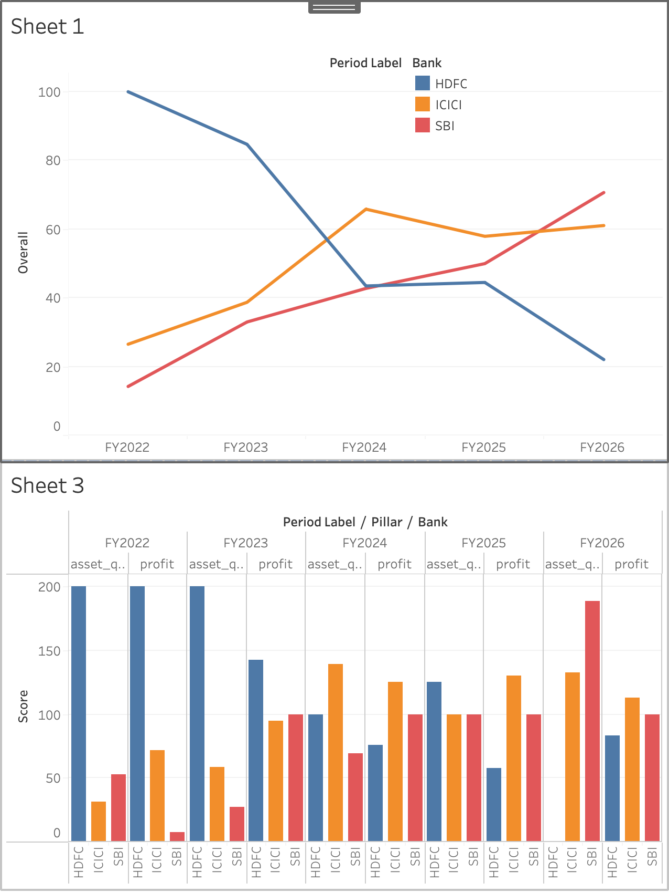

# Who is India's strongest bank?

### An audit-grade scorecard of SBI vs HDFC Bank vs ICICI Bank, FY2022–FY2026


---

## The 5-second summary

- **HDFC Bank is India's strongest of the three** on this scorecard, with a mean overall score of **59.0** against **50.0** for ICICI Bank and **42.1** for State Bank of India. The result is not close to a knife-edge: HDFC Bank finishes first in **100% of 10,000 randomised pillar weightings**.
- **The margin is built on both pillars.** HDFC Bank leads on asset quality (pillar score **62.5** against 46.2 and 43.8) and on profitability (**55.9** against 53.4 and 40.7). Because it leads on both, no reweighting of the two can change the outcome — which is exactly what the sensitivity test confirms.
- **The post-merger regime tells a different story.** Restricted to FY2024–FY2026, ICICI Bank leads with **61.6**, ahead of State Bank of India on **54.5** and HDFC Bank on **36.7** — the same structural break that makes the full-window comparison necessary also reverses it.

---

## The question

> **Which of these three banks is strongest on bad loans, profit and efficiency across FY2022–FY2026 — and does that ranking survive changing the assumptions behind it?**

Most comparisons of this kind pick a set of weights, add up the scores and report a single winner. The weakness is that the weights are one person's judgement. This study scores the banks, then re-draws the pillar weights **10,000 times** from a uniform distribution over the weight simplex to measure whether the answer moves at all.

---

## Methodology

- **Primary sources only.** Twenty-one documents — annual reports, quarterly results, investor presentations and Pillar 3 disclosures for all three banks across FY2022–FY2026, roughly **5,220 pages** — collected from the banks' own investor-relations channels.
- **Standalone financials throughout.** Consolidated figures blend differing subsidiary structures and would compare group shape rather than banking performance, so every metric is taken on the standalone basis.
- **Every number carries its source.** Each value in `data/source_log.csv` records its document, page number, matched line and a SHA-256 of the file it came from, so any figure in this note can be traced back to a page and re-checked. `outputs/manifest.json` hashes every output of the run.
- **Assumption risk is measured, not assumed away.** The 10,000-draw sensitivity test reports the probability of each bank finishing first, second and third, and the exact weight at which leadership would change hands. A verdict is only described as stable if it holds on both the full window and a merger-clean one.
- **The HDFC Ltd merger is handled structurally.** The merger completed on 1 July 2023, so FY2024 contains roughly nine months of the combined entity. Every time series marks it with a dotted line, CAGR refuses to cross it, and the scorecard is computed on both FY2022–FY2026 and FY2024–FY2026.

---

## Key Findings

- **HDFC Bank leads the FY2022–FY2026 scorecard** with a mean overall score of **59.0**, ahead of ICICI Bank on **50.0** and State Bank of India on **42.1**.
- **The ranking is completely robust to the weighting.** Across 10,000 random draws of the pillar weights, HDFC Bank ranks first in **100.0%** of runs, ICICI Bank second in **100.0%**, and State Bank of India third in **100.0%**. No weighting of the pillars changes the order — there is no flip threshold to report because none exists.
- **HDFC Bank leads on both pillars, which is why nothing moves.** It scores **62.5** on asset quality against ICICI Bank's 46.2 and State Bank of India's 43.8, and **55.9** on profitability against ICICI Bank's 53.4 and State Bank of India's 40.7. A bank that leads on every pillar cannot be overturned by reweighting those pillars, and the 10,000-draw test bears that out.
- **The merger-clean window reverses the ranking.** On FY2024–FY2026, ICICI Bank leads with **61.6**, State Bank of India follows on **54.5** and HDFC Bank sits at **36.7**. The two windows disagree, and that disagreement is the finding — which is why both are always shown.

---

## Visual gallery



*How often each bank finishes first across 10,000 randomised pillar weightings.*





*Pillar scores are computed within each financial year, so the three banks span 0 to 100 in every period.*

### Interactive Tableau Dashboard

[Click here to view the interactive Tableau dashboard on Tableau Public](https://public.tableau.com/views/IndiaBankScorecard-SBIvsHDFCvsICICI/Bankscorecarddashboard?:language=en-US&:sid=&:redirect=auth&:display_count=n&:origin=viz_share_link)
---

## How to reproduce

```bash
conda env create -f environment.yml
conda activate bank-scorecard
python run_all.py
```

`run_all.py` rebuilds every table, chart and export from `data/source_log.csv` and writes a hash of each output to `outputs/manifest.json`. The full audit trail — validation checks, coverage by bank and metric, and the scoring inputs — is regenerated on every run.

---

## Repository map

```
src/          extraction, cross-verification, validation, scoring, charts, exports
tests/        38 tests covering the validation rules and the scoring mathematics
data/         raw source PDFs (never committed) and the committed source log
outputs/      charts, tables, Tableau exports, run manifest
docs/         understanding guide, case-study memo, investor-relations source map
tableau/      Tableau Public build guide
```

## Data sources

| Source | Used for |
|---|---|
| [SBI investor relations](https://sbi.bank.in/web/investor-relations) | Annual reports FY2022–FY2026, Q1 FY2027 presentation |
| [HDFC Bank investor relations](https://www.hdfcbank.com/personal/about-us/investor-relations/financial-results) | Annual reports FY2022–FY2026, Q1 FY2027 results |
| [ICICI Bank investor relations](https://www.icicibank.com/about-us/investor-relations) | Annual reports FY2022–FY2026, Pillar 3 disclosures, Q1 FY2027 results |
| [RBI DBIE](https://data.rbi.org.in) | System-level benchmarks (context only) |

Raw documents are not committed — they are large and remain the copyright of the respective banks and of the Reserve Bank of India.

---

## Scope and limitations

- **This version focuses on Asset Quality, Profitability, and Efficiency. Certain metrics were verified directly from Pillar 3 disclosures due to differences in standardized reporting across peer banks.** Efficiency inputs are published on differing bases across the peer group, so the weighting is applied to the two pillars carrying comparable data — Asset Quality and Profitability — renormalised proportionally and identically for every bank, and each scored row records the pillars used.
- **The 0–100 scale represents a relative ranking within this 3-bank peer group, not an absolute score.** With three entities, min-max normalisation always spans 0 to 100, so small real differences look large. No score is published without its raw value alongside.
- **The HDFC Ltd merger (July 2023) introduces a structural break. Pre-merger and post-merger figures are treated as distinct regimes**, and a verdict is only considered stable if it survives both windows.
- **Ratio definitions are not identical across the three banks.** Where a bank reports a variant — a core cost-to-income ratio, or a provision coverage figure including technical write-offs — the difference is recorded in the source log rather than smoothed away.

## Disclaimer

This is an educational analysis of publicly available disclosures. It is **not investment advice** and contains **no** buy, sell or hold recommendation on any security. It is not affiliated with, endorsed by, or reviewed by any of the institutions named. All financial data belongs to the respective banks and to the Reserve Bank of India and is cited with source. Past figures do not predict future results.
