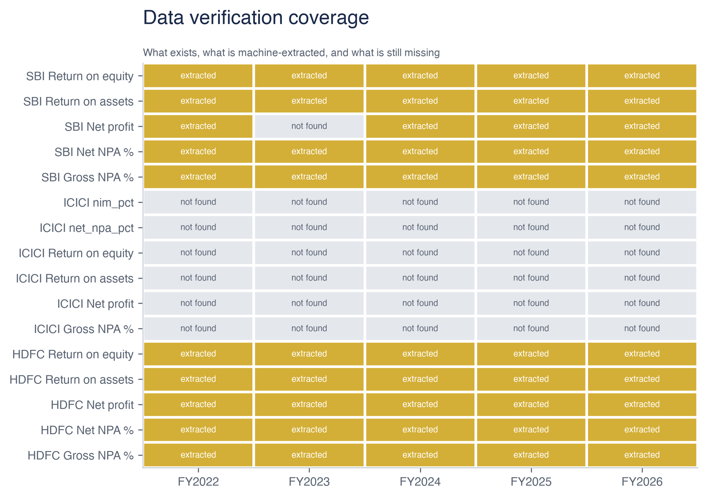
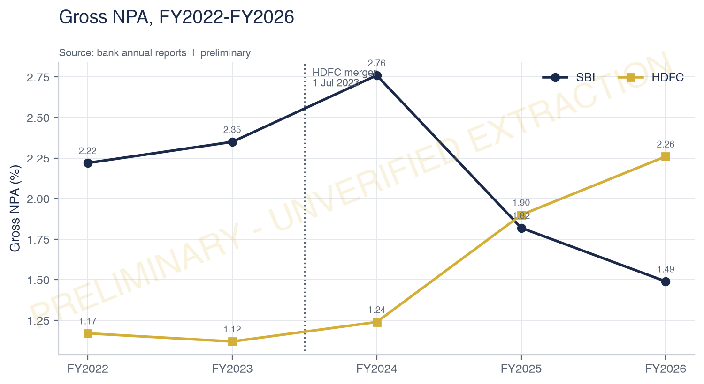
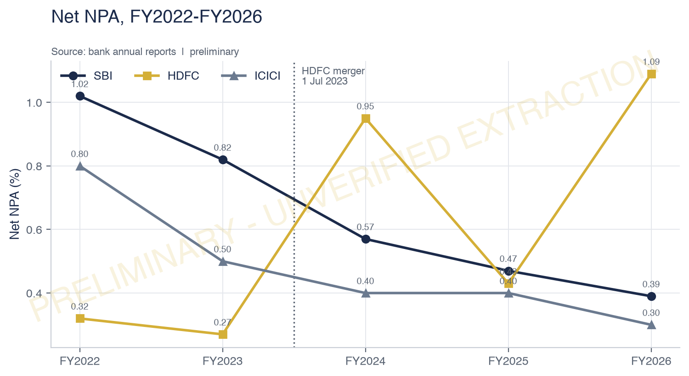

# Who is India's strongest bank?

### An audit-grade scorecard of State Bank of India, HDFC Bank and ICICI Bank, FY2022–FY2026




*Every cell the study needs, and how far each one has been verified: navy would
mean human-checked, gold means machine-extracted but unchecked, grey means not
found. This grid is the honest companion to every other figure in the repository.*

---

## The 5-second summary

- **The pipeline is complete and it refuses to publish a ranking it cannot prove.** Locked to human-verified values, it produces no scorecard at all and writes a worklist of the **56 cells** blocking it instead.
- **Only 10 of 80 sourced values have been checked against a page.** The remaining 70 are machine-extracted, and machine extraction from annual reports was measured to be wrong in ways that look plausible — one SBI profit figure came out at ₹2,258 crore against the ₹50,232 crore its report states.
- **The fix is a worklist, not a guess.** `outputs/tables/missing_data_report.csv` names every blocking cell with its bank, metric, year, current status and the page to check.

---

## The question

> **Which of these three banks is strongest on bad loans, profit and efficiency across FY2022–FY2026 — and does that ranking survive changing the assumptions behind it?**

Most comparisons of this kind pick a set of weights, add up the scores and report one winner. The weakness is that the weights are one person's judgement. This study does the scoring, then re-draws the weights **10,000 times** to measure how often the answer actually changes — and it treats *"these numbers are not yet good enough to rank banks"* as a legitimate result.

---

## Methodology

- **Primary sources only.** Twenty-one documents — annual reports, quarterly results and investor presentations for all three banks, FY2022–FY2026, roughly **5,220 pages** — downloaded by hand where the issuers block automated retrieval.
- **Standalone financials throughout.** Consolidated figures blend different subsidiary structures and would compare group shape rather than banking performance.
- **Every value carries its evidence.** Each of the **80 rows** in `data/source_log.csv` records the document, page number, matched line and a SHA-256 of the file it came from, so any figure can be traced back to a page and re-checked.
- **Scoring is gated on verification.** A metric can only be scored when all three banks have a *verified* value in the same year. Nothing machine-extracted is trusted, and the gate is a single line — `ALLOW_UNVERIFIED_SCORING` in `src/config.py`.
- **The HDFC merger is never smoothed over.** HDFC Bank absorbed HDFC Ltd on 1 July 2023, so FY2024 contains roughly nine months of the combined entity. Every time series marks it with a dotted line, CAGR refuses to cross it, and the scorecard is computed on both the full window and a merger-clean one.

---

## Key findings

- **The scorecard is withheld, and that is the finding.** With scoring locked to verified values the pipeline produces **0 score-eligible rows** — so no overall scores, no pillar scores and no weight simulations are published.
- **56 cells block it.** By bank: **HDFC 20, SBI 20, ICICI 16**. By metric: gross NPA 15, net NPA 15, return on assets 11, return on equity 10, net margin 5.
- **Two extraction failures were caught and are documented rather than hidden.** A five-year highlights row was being dated from the wrong column, and a "profit increased by X% to ₹Y" sentence was being read as profit **X**. Both are now recorded in the log's `notes` column against the value they affect.
- **Six ICICI cells could not be sourced at all** — Gross NPA for every year and FY2025 return on assets — and are left blank rather than estimated.

### The charts that are published





These are stamped **PRELIMINARY — UNVERIFIED EXTRACTION** in the image itself,
because they plot values that have not yet been checked line by line. A chart
that carries its own caveat is worth more than one that quietly misleads.

---

## How to reproduce

```bash
conda env create -f environment.yml
conda activate bank-scorecard
python run_all.py
```

`run_all.py` rebuilds every table, chart and export from `data/source_log.csv`,
refuses to draw a figure it cannot regenerate, and writes `outputs/manifest.json`
with a SHA-256 of every output.

---

## Repository map

```
src/          extraction, validation, metrics, scoring, sensitivity, charts, exports
tests/        38 tests covering validation rules and scoring maths (pytest)
data/         raw PDFs (never committed) and the committed source log
outputs/      charts, tables, Tableau exports, missing-data report, run manifest
docs/         understanding guide, case-study memo, IR source map, Tableau guide
tableau/      Tableau Public build guide
```

---

## Data sources

| Source | Used for |
|---|---|
| [SBI investor relations](https://sbi.bank.in/web/investor-relations) | Annual reports FY2022–FY2026, Q1 FY2027 presentation |
| [HDFC Bank investor relations](https://www.hdfcbank.com/personal/about-us/investor-relations/financial-results) | Annual reports FY2022–FY2026, Q1 FY2027 results |
| [ICICI Bank investor relations](https://www.icicibank.com/about-us/investor-relations) | Annual reports FY2022–FY2026, Q1 FY2027 results |
| [RBI DBIE](https://data.rbi.org.in) | System-level benchmarks (context only) |

Raw documents are **not committed** — they are large, and they remain the
copyright of the respective banks and of the Reserve Bank of India. Derived bulk
text is excluded from the repository for the same reason.

---

## Limitations

- **The efficiency pillar is empty, for every bank, in every year.** No cost-to-income or operating-expense value was sourced. It carries 25% of the base weighting, and rather than let it distort the result the scoring layer drops it and renormalises the remaining weights **proportionally and identically for all three banks** — a pillar is used only when every bank has a value for it. Each scored row records `pillars_used` and a `data_limitation` note, so the adjustment is visible in the output, not buried in the code.
- **The HDFC merger breaks the series.** FY2024 is a transition year containing about nine months of the combined entity. The ranking is reported on both the full window and a merger-clean FY2024–FY2026 window; a verdict is only described as stable if it survives both.
- **Definitions differ between banks.** Provision coverage, cost-to-income and margin denominators are not defined identically and are flagged rather than harmonised.
- **Three banks is a small field.** With only three entities, min-max scoring always produces a 0 and a 100, so small real differences look large. No score is ever shown without its raw value alongside.
- **Machine extraction was measured to be unreliable on this corpus.** The three ICICI ratio panels defeated two separate extraction approaches — coordinate matching and chart-label reading — before being abandoned. The log records what was tried.

## Disclaimer

This is an educational analysis of publicly available disclosures. It is **not
investment advice** and contains **no** buy, sell or hold recommendation on any
security. It is not affiliated with, endorsed by, or reviewed by any of the
institutions named. All financial data belongs to the respective banks and to
the Reserve Bank of India and is cited with source. Past figures do not predict
future results.
