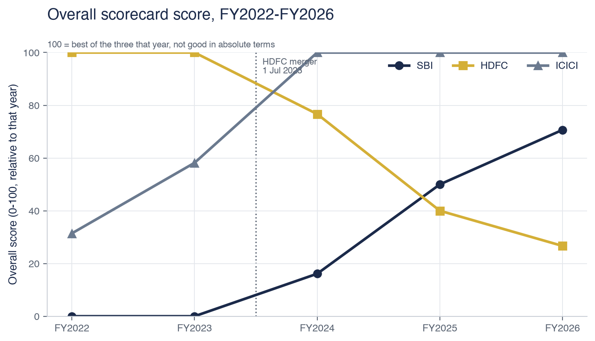

# Who is India's strongest bank?

### An audit-grade scorecard of State Bank of India, HDFC Bank and ICICI Bank, FY2022–FY2026




---

## The 5-second summary

- **No bank wins outright.** ICICI leads on the full FY2022–FY2026 window (mean score **77.9**), but HDFC Bank ranks first in **78.0%** of 10,000 random weightings, and HDFC also leads the merger-clean window.
- **SBI never ranks first** — not in a single one of the 10,000 weightings, and not in either window.
- **The verdict is not robust.** Move the asset-quality pillar weight above **0.685** and the leader flips from HDFC to ICICI. That threshold, not a single ranking, is the real result.

---

## The question

> Which of these three banks is strongest on bad loans, profit and efficiency — and does that ranking survive changing the assumptions behind it?

Most comparisons of this kind pick a set of weights, add up the scores and report one winner. The weakness is that the weights are one person's judgement. This study does the same scoring, then re-draws the weights **10,000 times** to measure how often the answer actually changes.

---

## Key findings

- **ICICI Bank tops the headline table** on the FY2022–FY2026 window with a mean overall score of **77.9**, against **68.7** for HDFC Bank and **27.4** for SBI.
- **HDFC Bank is the more likely winner once weights are varied.** Drawing pillar weights from a uniform distribution over the weight simplex, HDFC ranks first in **77.95%** of 10,000 runs, ICICI in **22.05%**, SBI in **0.00%**.
- **The merger-clean window reverses the order.** Restricted to FY2024–FY2026, ICICI scores **100.0**, HDFC **47.8** and SBI **45.6** — a different ranking from the full window, which is exactly why both are reported.
- **The result hinges on one weight.** HDFC holds first place while the asset-quality pillar is weighted below **0.685**; above that, leadership passes to ICICI. The profit pillar is less fragile — HDFC keeps the lead for any profit weight above **0.14**.

---

## Methodology

- **Primary sources only.** Twenty-one documents — annual reports, quarterly results and investor presentations for all three banks, FY2022–FY2026 — downloaded by hand where the issuers block automated retrieval. Roughly **5,220 pages**.
- **Standalone financials throughout.** Consolidated figures include different subsidiary structures and would compare group shape rather than banking performance.
- **Nothing is scored until it is sourced.** Every one of the **80 rows** in `data/source_log.csv` carries the document, page number, matched line and a SHA-256 of the file it came from.
- **Failure is explicit, not silent.** Values a machine located but a human has not checked are recorded as `auto_extracted` or `ocr_extracted`; a cell that could not be sourced is left blank rather than estimated.
- **Scoring is relative, and says so.** Metrics are oriented so higher is better and normalised 0–100 **within each year** across the three banks, so 100 means *best of these three that year*, never *good in absolute terms*. Pillars are asset quality 35%, profit 40%, efficiency 25% — and those weights are precisely what the sensitivity test probes.

---

## How to reproduce

```bash
conda env create -f environment.yml
conda activate bank-scorecard
python run_all.py
```

`run_all.py` rebuilds every table, chart and export from `data/source_log.csv` and writes `outputs/manifest.json` with a hash of each output.

---

## Repository map

```
src/          extraction, validation, metrics, scoring, sensitivity, charts, exports
tests/        validation and scoring tests (pytest)
data/         raw PDFs (not committed) and the committed source log
outputs/      charts, tables, Tableau exports, run manifest
docs/         understanding guide, case-study memo, source map
tableau/      Tableau Public build guide
```

---

## Data sources

| Source | Used for |
|---|---|
| [SBI investor relations](https://sbi.bank.in/web/investor-relations) | Annual reports FY2022–FY2026, Q1 FY2027 presentation |
| [HDFC Bank investor relations](https://www.hdfcbank.com/personal/about-us/investor-relations/financial-results) | Annual reports FY2022–FY2026, Q1 FY2027 results |
| [ICICI Bank investor relations](https://www.icicibank.com/about-us/investor-relations) | Annual reports FY2022–FY2026, Q1 FY2027 results |
| [RBI DBIE](https://data.rbi.org.in) | System-level benchmarks (context only) |

Raw documents are **not committed** — they are large and remain the copyright of the respective banks. See `data/raw/MANUAL_DOWNLOAD_NEEDED.txt`.

---

## Limitations

- **Extraction is not yet fully verified.** Of the 80 source rows, 20 ICICI cells are still blank and the remainder are machine-located. Automated extraction from annual reports can capture a segment figure or mis-date a multi-year row; `data/source_log.csv` records the page and matched line for every value so each one can be checked. **Treat the specific numbers in this README as provisional until that review is complete.**
- **The HDFC merger.** HDFC Bank absorbed HDFC Ltd on 1 July 2023, so FY2024 contains roughly nine months of the combined entity. Every time series marks it, and the scorecard is reported on both windows.
- **Definitions differ between banks.** Provision coverage, cost-to-income and margin denominators are not defined identically, and are flagged rather than harmonised.
- **Two pillars are thin.** The efficiency pillar has no data for any bank in this dataset, and the profit pillar rests on fewer metrics than intended, which is part of why the ranking moves between windows.
- **Three banks is a small field.** With only three entities, min-max scoring always produces a 0 and a 100, so small real differences look large.
- **CAGR is refused across the merger** by design, because the resulting number would measure the merger rather than the business.

## Disclaimer

This is an educational analysis of publicly available disclosures. It is **not investment advice**, contains **no** buy, sell or hold recommendation on any security, and is not affiliated with or reviewed by any of the institutions named. All financial data belongs to the respective banks and to the Reserve Bank of India and is cited with source. Past figures do not predict future results.
